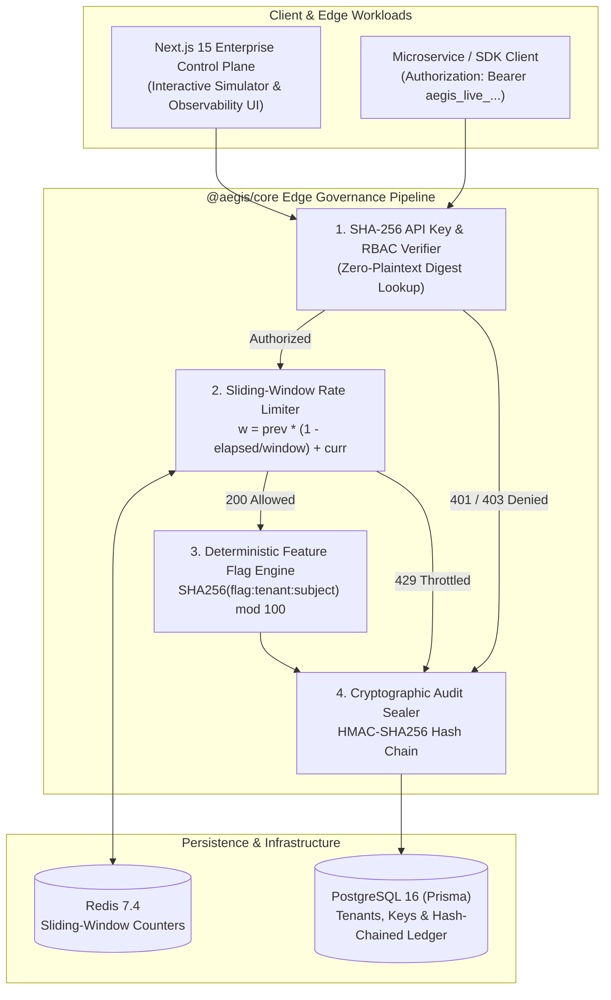

<div align="center">

# 🛡️ AegisCloud — Enterprise Multi-Tenant API Gateway, Feature Flag & Cryptographic Audit Platform

**A production-grade cloud governance control plane demonstrating distributed systems engineering: Sliding-Window Counter Rate Limiting, Stateless Deterministic SHA-256 Feature Rollouts, Multi-Tenant RBAC API Key Management, and a Tamper-Evident Hash-Chained Audit Ledger.**

[](https://www.typescriptlang.org/)
[](https://nextjs.org/)
[](https://www.postgresql.org/)
[](https://redis.io/)
[](./.github/workflows/ci.yml)
[](./LICENSE)

</div>

---

## 🎯 Why This Project Exists

Most portfolio projects only demonstrate basic CRUD operations. **AegisCloud** is architected to showcase the core primitives that power modern enterprise cloud platforms (such as Cloudflare, Stripe, LaunchDarkly, and AWS QLDB):

1. **O(1) Sliding-Window Counter Rate Limiter** — Eliminates the 2× boundary burst vulnerability of fixed-window counters while avoiding the $O(N)$ memory overhead of rolling sorted-set logs.
2. **Stateless Deterministic Feature Flag Engine** — Evaluates tenant allowlists, attribute-based rules (`EQUALS`, `IN`, `ENDS_WITH`, `GREATER_THAN`), and progressive percentage rollouts using `SHA-256(flagKey : tenantId : subjectId) mod 100` for sticky user bucketing with **zero database lookups**.
3. **Tamper-Evident Cryptographic Audit Ledger** — Links every state mutation to its predecessor via `HMAC-SHA256(sequence | timestamp | tenant | actor | action | canonicalMetadata | previousHash)`. Includes an interactive **Chaos / Tamper Simulator** to demonstrate real-time breach detection and cryptographic re-sealing.
4. **Zero-Plaintext Multi-Tenant RBAC API Keys** — Generates CSPRNG API keys (`aegis_live_<tenant>_<secret>`), stores only their `SHA-256` digest, and enforces granular permission scopes (`gateway:proxy`, `flags:write`, `keys:manage`, `audit:verify`, `tenants:admin`).

---

## 🏗️ System Architecture



---

## 📂 Monorepo Structure

```text
aegis-cloud-platform/
├── packages/
│   └── core/                         # @aegis/core — Pure TypeScript Cryptographic & Governance Engines
│       ├── src/
│       │   ├── audit-ledger.ts       # HMAC-SHA256 hash-chained tamper-evident audit ledger
│       │   ├── rate-limiter.ts       # O(1) Sliding-Window Counter rate limiter with HTTP 429 headers
│       │   ├── feature-flags.ts      # Deterministic SHA-256 bucketing & attribute rule evaluator
│       │   ├── rbac.ts               # CSPRNG API key generator, SHA-256 hashing & scope matrix
│       │   └── __tests__/
│       │       └── core.test.ts      # Automated unit test suite (node:test)
├── apps/
│   └── web/                          # @aegis/web — Next.js 15 App Router Control Plane & REST APIs
│       └── src/
│           ├── app/api/v1/           # REST APIs (/gateway, /flags, /audit, /keys)
│           ├── components/           # Interactive Enterprise Dashboard & Simulator
│           └── lib/store.ts          # Seeded multi-tenant state & telemetry engine
├── prisma/
│   └── schema.prisma                 # Production PostgreSQL schema for multi-tenant isolation
├── docker-compose.yml                # Full stack orchestration (PostgreSQL 16 + Redis 7.4 + Web)
├── Dockerfile                        # Multi-stage production Node 22 Alpine container build
└── .github/workflows/ci.yml          # GitHub Actions CI pipeline
```

---

## 🚀 Quick Start (Zero-Setup Interactive Mode)

You can run the entire platform locally in under 60 seconds **without** needing external Postgres or Redis instances running (the Control Plane automatically boots with an in-memory multi-tenant state store pre-seeded with 3 enterprise tenants, API keys, feature flags, and signed audit blocks):

```bash
# 1. Install monorepo dependencies
npm install

# 2. Build @aegis/core and run the cryptographic & rate-limiter unit tests
npm test

# 3. Start the Next.js 15 Enterprise Control Plane on http://localhost:3000
npm run dev
```

### Running with Docker Compose (PostgreSQL 16 + Redis 7.4)

```bash
docker compose up --build -d
```

---

## 🔬 Key Architectural Decision Records (ADRs)

### ADR-001: Sliding-Window Counter Rate Limiting
Fixed-window rate limiters allow 2× traffic spikes at window boundaries, while sliding logs consume $O(N)$ memory per active key. In [`packages/core/src/rate-limiter.ts`](./packages/core/src/rate-limiter.ts), AegisCloud interpolates between the previous window and current window in $O(1)$ space:

$$\text{weight} = \text{prevCount} \times \left(1 - \frac{t_{\text{now}} - t_{\text{windowStart}}}{W}\right) + \text{currCount}$$

### ADR-002: Stateless Deterministic Feature Rollouts
To ensure sticky variant assignment across stateless edge workers without querying PostgreSQL on every request, [`packages/core/src/feature-flags.ts`](./packages/core/src/feature-flags.ts) hashes the tuple `(flagKey, tenantId, subjectId)` with `SHA-256` and maps the first 32-bit unsigned integer into `[0, 99]`.

### ADR-003: Tamper-Evident Cryptographic Audit Trail
In [`packages/core/src/audit-ledger.ts`](./packages/core/src/audit-ledger.ts), every audit record stores `previousHash` and computes an `HMAC-SHA256` signature over canonicalized JSON metadata. If a rogue actor modifies any historical database row, `verifyChain()` immediately pinpoints the exact compromised sequence number.

