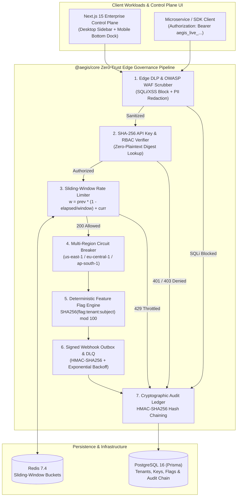

<div align="center">

# 🛡️ AegisCloud — Enterprise Multi-Tenant API Gateway, Feature Flag, Resilience & Cryptographic Audit Platform

**A production-grade cloud governance and edge security control plane showcasing distributed systems engineering: Sliding-Window Counter Rate Limiting, Multi-Region Circuit Breakers & Failover, Stateless Deterministic SHA-256 Feature Rollouts, Signed Webhook Outbox & DLQ, Zero-Trust Edge DLP/WAF Scrubbing, Multi-Tenant RBAC API Keys, and a Tamper-Evident Hash-Chained Audit Ledger.**

[](https://www.typescriptlang.org/)
[](https://nextjs.org/)
[](https://www.postgresql.org/)
[](https://redis.io/)
[](./.github/workflows/ci.yml)
[](#)
[](./LICENSE)

</div>

---

## 📖 Executive Summary

Most portfolio repositories only demonstrate basic CRUD endpoints. **AegisCloud** is architected from the ground up to demonstrate the mission-critical infrastructure primitives that power Tier-1 cloud platforms (**Cloudflare, Stripe, LaunchDarkly, Envoy, and AWS QLDB**).

It is structured as a **TypeScript Monorepo** containing a zero-dependency cryptographic & distributed systems engine (`@aegis/core`) paired with a responsive, real-time **Next.js 15 Enterprise Control Plane & Interactive Chaos Simulator** (`@aegis/web`).

---

## ✨ Complete Feature Matrix (What We Built)

| Enterprise Capability | Core Engine Implementation | Interactive Control Plane Feature |
| :--- | :--- | :--- |
| **1. O(1) Sliding-Window Counter Rate Limiter** | [`packages/core/src/rate-limiter.ts`](./packages/core/src/rate-limiter.ts) — Interpolates request weights across fixed window boundaries (`prevCount * (1 - elapsed) + currCount`) with burst multipliers and IETF `X-RateLimit-*` / `Retry-After` headers. | **Edge Request Dispatch Studio**: Send single requests or trigger a **10× Load Spike** to watch `HTTP 429` throttling, live SVG area telemetry, and quota gauges in real time. |
| **2. Multi-Region Circuit Breakers & Auto-Failover** | [`packages/core/src/circuit-breaker.ts`](./packages/core/src/circuit-breaker.ts) — Implements the `CLOSED -> OPEN -> HALF_OPEN` state machine across `us-east-1`, `eu-central-1`, and `ap-south-1`, automatically rerouting traffic to lowest-latency healthy regions. | **Regional Failover Mesh**: Trip any region to `OPEN` (simulating an outage), test `HALF_OPEN` health probes, and restore to `CLOSED`. |
| **3. Stateless Deterministic Feature Flag Engine** | [`packages/core/src/feature-flags.ts`](./packages/core/src/feature-flags.ts) — Evaluates tenant allowlists, attribute targeting rules (`EQUALS`, `IN`, `ENDS_WITH`, `GREATER_THAN`), and sticky percentage rollouts via `SHA-256(flagKey:tenantId:subjectId) mod 100` with **0ms DB I/O**. | **Feature Rollout Studio & Bucketing Sandbox**: Adjust rollout sliders (`0–100%`), toggle flags, and test how any `subjectId` deterministically hashes into a sticky 0–99 bucket. |
| **4. Tamper-Evident SHA-256 Audit Ledger** | [`packages/core/src/audit-ledger.ts`](./packages/core/src/audit-ledger.ts) — Links every state mutation to its predecessor via `HMAC-SHA256(seq \| ts \| tenant \| actor \| action \| canonicalMeta \| prevHash)`. | **Chaos Tamper Simulator**: Click **Simulate Rogue DB Tampering Attack** to mutate a historical row and watch `verifyChain()` pinpoint the exact compromised block, then **Re-Compute & Seal** the chain. |
| **5. Signed Webhook Outbox & Dead-Letter Queue (DLQ)** | [`packages/core/src/webhook-dispatcher.ts`](./packages/core/src/webhook-dispatcher.ts) — Signs outbound payloads with `HMAC-SHA256` (`t=<ts>,v1=<sig>`), schedules exponential backoff (`15s, 30s, 60s`), and isolates exhausted events in a Dead-Letter Queue. | **Webhook & DLQ Inspector**: Emit `200 OK` events, simulate `503` downstream timeouts, inspect cryptographic signatures, and one-click **Replay DLQ**. |
| **6. Zero-Trust Edge DLP & OWASP WAF Scrubber** | [`packages/core/src/dlp-scrubber.ts`](./packages/core/src/dlp-scrubber.ts) — Redacts PII (Credit Card PANs, SSNs, Emails, Bearer/API tokens) at the edge and blocks OWASP SQL Injection (`UNION SELECT`, `OR 1=1`) & XSS payloads. | **Live DLP & WAF Sandbox**: Inspect JSON payloads to see automatic PII masking (`[REDACTED_PAN_****_8899]`) or fire a **Test SQLi Attack** to trigger an edge WAF block. |
| **7. Zero-Plaintext Multi-Tenant RBAC & API Keys** | [`packages/core/src/rbac.ts`](./packages/core/src/rbac.ts) — Generates CSPRNG keys (`aegis_live_<tenant>_<random>`), stores only their `SHA-256` digest, and enforces 5 role tiers (`OWNER`, `ADMIN`, `DEVELOPER`, `AUDITOR`, `SERVICE_CLIENT`). | **Identity & RBAC Key Manager**: Provision role-scoped API keys (revealing the raw secret once), copy keys, and revoke compromised credentials. |
| **8. Stripe-Grade RFC Idempotency-Key Engine** | [`packages/core/src/idempotency.ts`](./packages/core/src/idempotency.ts) — Locks `Idempotency-Key` headers per tenant with canonical SHA-256 request body hashing; replays cached responses on duplicate network retries and rejects mutated payloads with `HTTP 422 Conflict`. | **Idempotency Replay & Conflict Simulator**: Retry wire transfers with the same key (`REPLAYED_FROM_CACHE`) or mutate the settlement amount to trigger `CONFLICT_PAYLOAD_MISMATCH`. |
| **9. AI Token Metering, Semantic Cache & FinOps Governor** | [`packages/core/src/ai-governor.ts`](./packages/core/src/ai-governor.ts) — Tracks input/output tokens across `claude-3-7-sonnet`, `gpt-4o-enterprise`, and `gemini-2-5-pro`, serves deterministic edge semantic cache hits at `$0.00` cost (`2.1ms`), and enforces hard USD budgets. | **AI FinOps Studio**: Execute metered LLM prompts, test instant semantic cache hits on repeated queries, and monitor real-time tenant USD spend. |
| **10. Progressive Canary Traffic Splitter & Auto-Rollback** | [`packages/core/src/canary-router.ts`](./packages/core/src/canary-router.ts) — Splits traffic between Stable (`v2.4.0`) and Canary (`v2.5.0`) revisions and automatically rolls back Canary weight to `0%` when error rates breach the SLO threshold (`>2.5%`). | **Canary Rollout Controller**: Adjust split weights (`0%`–`100%`), click **Simulate Canary 6.8% Error Spike** to trigger instant `AUTO_ROLLED_BACK`, or promote Canary to `100%`. |
| **11. Desktop & Mobile-First Responsive Control Plane** | [`ControlPlaneDashboard.tsx`](./apps/web/src/components/ControlPlaneDashboard.tsx) — Enterprise dark-mode glassmorphic UI with an executive sidebar on desktop and a fixed thumb-friendly **Bottom Navigation Dock** on mobile devices. | Works seamlessly across 4K monitors, laptops, tablets, and mobile phones (`device-width` viewport, responsive touch grids, and overflow-safe hash inspectors). |

---

## 🏗️ System Architecture Diagram



---

## 📂 Monorepo Directory Structure

```text
aegis-cloud-platform/
├── packages/
│   └── core/                             # @aegis/core — Pure TypeScript Distributed & Cryptographic Engines
│       ├── src/
│       │   ├── audit-ledger.ts           # HMAC-SHA256 hash-chained tamper-evident audit ledger
│       │   ├── rate-limiter.ts           # O(1) Sliding-Window Counter rate limiter with HTTP 429 headers
│       │   ├── feature-flags.ts          # Deterministic SHA-256 bucketing & attribute rule evaluator
│       │   ├── rbac.ts                   # CSPRNG API key generator, SHA-256 hashing & scope matrix
│       │   ├── circuit-breaker.ts        # Multi-region circuit breaker (CLOSED / OPEN / HALF_OPEN)
│       │   ├── webhook-dispatcher.ts     # HMAC-SHA256 webhook signer, exponential backoff & DLQ
│       │   ├── dlp-scrubber.ts           # Zero-Trust PII redaction (PAN, SSN, Email, Token) & WAF
│       │   ├── index.ts                  # Public barrel exports
│       │   └── __tests__/
│       │       └── core.test.ts          # Automated unit test suite (7 test suites via node:test)
├── apps/
│   └── web/                              # @aegis/web — Next.js 15 App Router Control Plane & REST APIs
│       └── src/
│           ├── app/
│           │   ├── api/v1/
│           │   │   ├── gateway/route.ts      # Live API Gateway proxy, burst simulator & quota reset
│           │   │   ├── resilience/route.ts   # Circuit breaker failover, webhook DLQ & DLP/WAF API
│           │   │   ├── flags/route.ts        # Feature flag CRUD & deterministic bucket evaluator
│           │   │   ├── audit/route.ts        # Hash-chain verifier, rogue tamper & reseal API
│           │   │   └── keys/route.ts         # Multi-tenant RBAC API key issuer & revocation API
│           │   ├── layout.tsx            # Root layout with mobile viewport & dark theme config
│           │   └── page.tsx              # Control Plane entry page
│           ├── components/
│           │   └── ControlPlaneDashboard.tsx # Full Enterprise UI (Sidebar, SVG Telemetry, Mobile Dock)
│           └── lib/
│               └── store.ts              # Pre-seeded multi-tenant state store (3 tenants, keys, traces)
├── prisma/
│   └── schema.prisma                     # Production PostgreSQL 16 schema (Tenants, Keys, Flags, Ledger)
├── docker-compose.yml                    # Full stack orchestration (PostgreSQL 16 + Redis 7.4 + Web)
├── Dockerfile                            # Multi-stage production Node 22 Alpine container build
└── .github/workflows/ci.yml              # GitHub Actions CI pipeline (Build + Typecheck + Unit Tests)
```

---

## 🚀 Getting Started (Zero-Setup Local Run)

The platform is designed so recruiters, hiring managers, and engineers can run and test every feature in **under 60 seconds** without needing external database setup (it automatically boots with a pre-seeded multi-tenant in-memory state store, while also including full Docker Compose + Prisma configs for PostgreSQL 16 and Redis 7.4).

### 1. Install Dependencies & Run Unit Tests
```bash
npm install
npm test
```

### 2. Start the Interactive Enterprise Control Plane
```bash
npm run dev
```
Open **[http://localhost:3000](http://localhost:3000)** in your browser (or mobile device).

### 3. (Optional) Run Full Stack with Docker Compose (PostgreSQL 16 + Redis 7.4)
```bash
docker compose up --build -d
```

---

## 🧪 Interactive Walkthrough (What to Try in the UI)

1. **Trigger Sliding-Window Rate Limiting (`Edge API Gateway` tab)**:
   - Click **10× Spike** twice to exceed the tenant's per-minute quota.
   - Watch the **HTTP Edge Response** switch to `HTTP/2 429 RATE LIMITED`, the SVG telemetry graph plot amber throttle markers, and the quota bar turn red. Click **Reset Quota** to clear the bucket.
   - Click **Copy cURL** to copy the exact `curl` command for terminal testing.
2. **Simulate a Regional Cloud Outage & Webhook DLQ (`Resilience, Webhooks & DLP` tab)**:
   - Under `us-east-1`, click **Simulate Outage (Trip OPEN)**. Notice the sidebar badge immediately alert `FAILOVER` and latency jump to `840 ms`.
   - In **Signed Webhook Outbox**, click **Simulate 503 Timeout** to watch exponential backoff scheduling, then click **Replay DLQ** to recover failed deliveries.
   - In **Zero-Trust Edge DLP & WAF**, click **Test SQLi Attack** to watch the edge WAF block a `UNION SELECT` injection and log a `CRITICAL` block in the audit chain.
3. **Test Deterministic Sticky Rollouts (`Feature Rollouts` tab)**:
   - Drag any flag's rollout percentage slider and test customer IDs in the **Deterministic Bucketing Sandbox** to verify `SHA256(flagKey + subjectId) mod 100`.
4. **Simulate a Database Breach (`Cryptographic Ledger` tab)**:
   - Click **Simulate Rogue DB Tampering Attack** to inject an unauthorized payload mutation into a historical audit block.
   - Watch the top status bar flash red (`TAMPER ALERT AT BLOCK #...`) as the SHA-256 hash chain detects the exact altered sequence number. Click **Re-Compute & Seal Hash Chain** to repair the ledger.

---

## 📐 Architectural Decision Records (ADRs)

### ADR-001: Sliding-Window Counter Rate Limiting
Fixed-window counters allow $2\times$ traffic spikes at window boundaries, while sliding sorted-set logs require $O(N)$ memory per active key. In [`packages/core/src/rate-limiter.ts`](./packages/core/src/rate-limiter.ts), AegisCloud interpolates between the previous window and current window in $O(1)$ space:

$$\text{weight} = \text{prevCount} \times \left(1 - \frac{t_{\text{now}} - t_{\text{windowStart}}}{W}\right) + \text{currCount}$$

### ADR-002: Stateless Deterministic Feature Flag Bucketing
To guarantee that a customer always receives a consistent feature variant across horizontally scaled edge nodes without querying PostgreSQL on every request, [`packages/core/src/feature-flags.ts`](./packages/core/src/feature-flags.ts) computes a 32-bit unsigned integer from the `SHA-256` digest of `(flagKey, tenantId, subjectId)` modulo 100.

### ADR-003: Tamper-Evident Cryptographic Audit Chaining
Standard SQL audit tables can be silently altered by a compromised administrator account. In [`packages/core/src/audit-ledger.ts`](./packages/core/src/audit-ledger.ts), every audit event stores `previousHash` and computes an `HMAC-SHA256` signature over canonicalized JSON metadata. Modifying any historical row invalidates its digest and breaks the chain link for all subsequent blocks.

---

## 📜 License

Distributed under the **MIT License**. Built as an enterprise distributed systems showcase.
